# Neon Dungeon

### ▶ [Play now: dliedke.github.io/neon-dungeon](https://dliedke.github.io/neon-dungeon/)

A cyberpunk isometric action RPG that runs right in the browser, on desktop and mobile.
The game is shown in **English or Portuguese** based on your browser language.

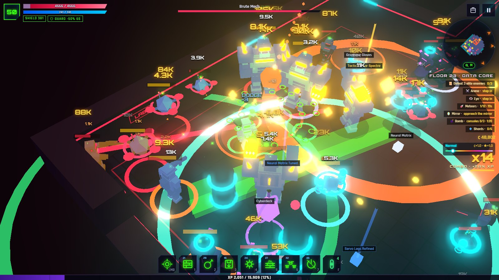

## Screenshots

<table>
  <tr>
    <td width="50%">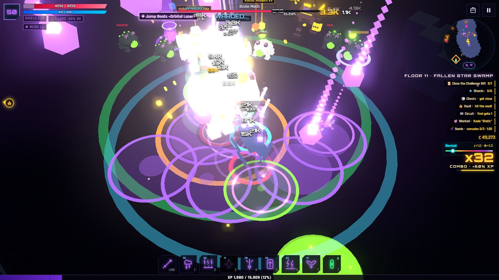<br><sub><b>Valkyrie</b> calling down lightning in the Fallen Star Swamp</sub></td>
    <td width="50%">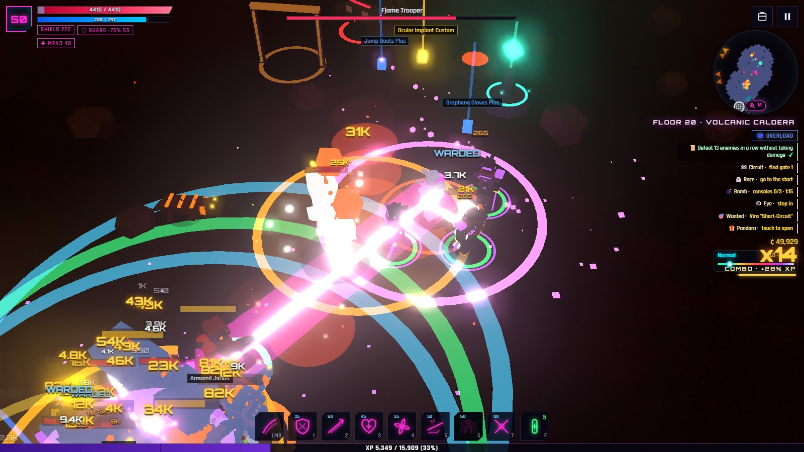<br><sub><b>Blade</b> carving through a horde in the Volcanic Caldera</sub></td>
  </tr>
  <tr>
    <td>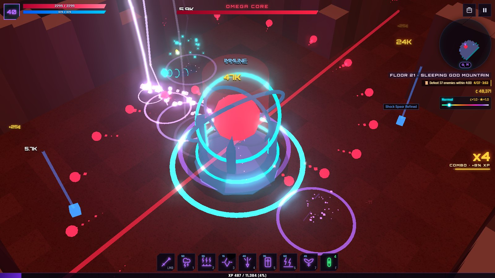<br><sub>Boss fight: the <b>Omega Core</b> on the Sleeping God Mountain</sub></td>
    <td>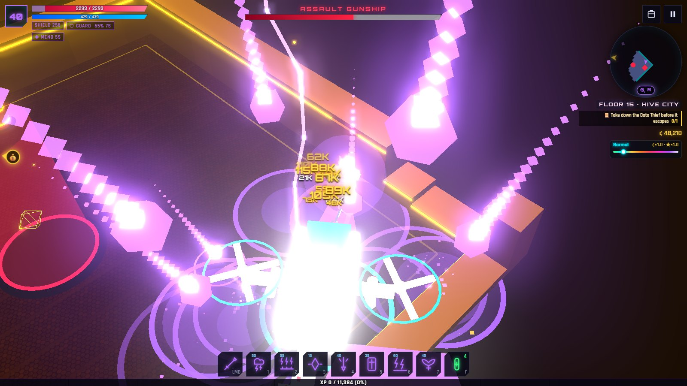<br><sub>Boss fight: the <b>Assault Gunship</b> in Hive City</sub></td>
  </tr>
  <tr>
    <td>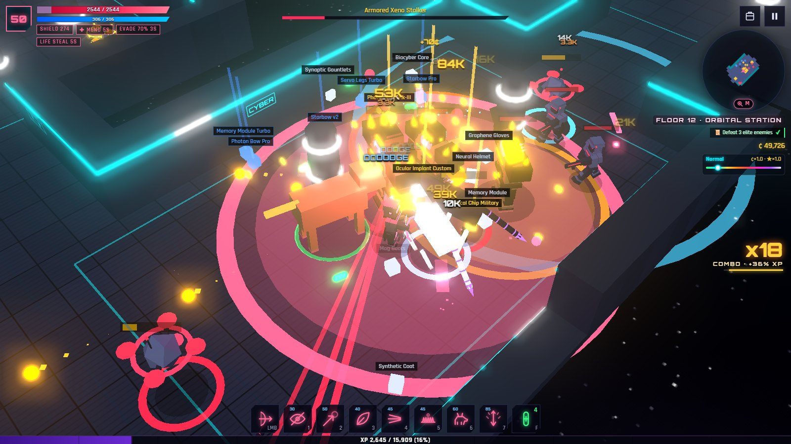<br><sub><b>Huntress</b> against elites on the Orbital Station</sub></td>
    <td>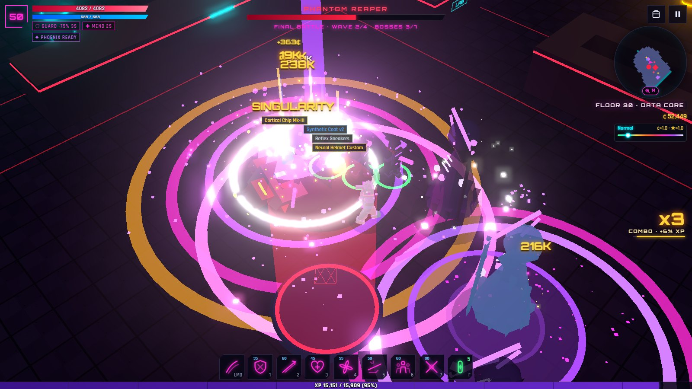<br><sub>The <b>final battle</b> on floor 50: the bosses come in waves</sub></td>
  </tr>
  <tr>
    <td>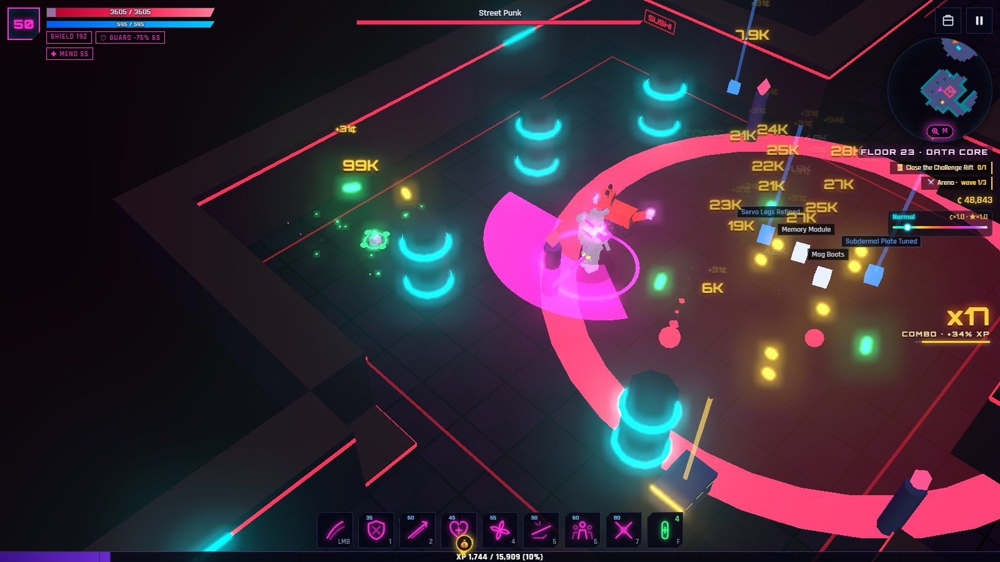<br><sub>Floor event: the <b>Gladiator Arena</b></sub></td>
    <td>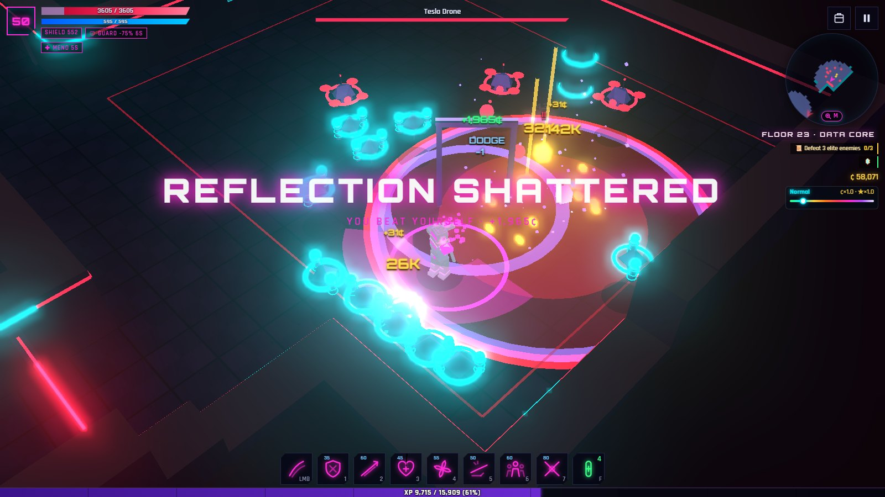<br><sub>Floor event: the <b>Mirror Duel</b> against your own reflection</sub></td>
  </tr>
  <tr>
    <td>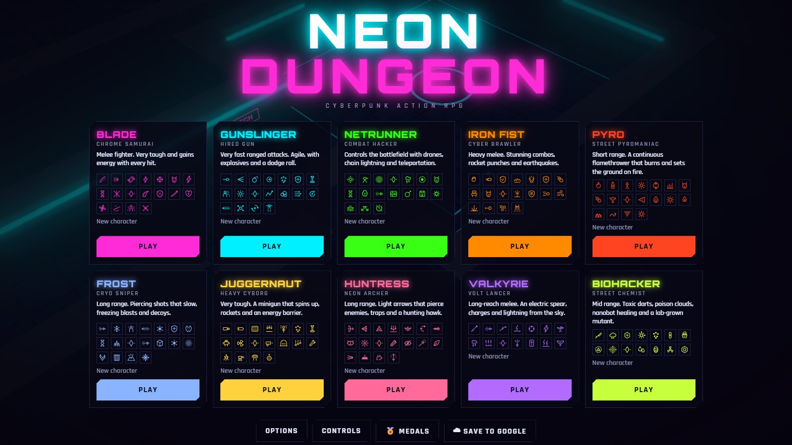<br><sub>10 classes, each with its own skill tree</sub></td>
    <td>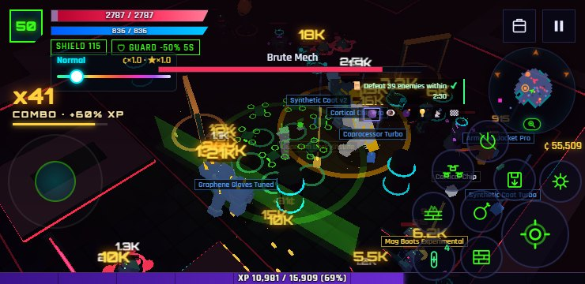<br><sub>Plays on phones too, with touch controls (and on gamepad)</sub></td>
  </tr>
</table>

## Goal

Descend through 50 dungeon floors, defeat enemies, collect gear and level up your character.
Find the glowing **elevator** on each floor to go down. Every 3 floors, a **boss** guards the exit (16 boss floors per run, the 7 bosses come back stronger).
On **floor 50**, the final battle pits you against all 7 bosses in waves: two at a time, and when both fall the next two arrive. Defeat them all to win the game, see your class's ending and earn the final-battle medals.
Items marked with **▲** and a green glow are better than what you have equipped.

After you win, the same character can descend again from floor 1 in **Nightmare ☠️** and then **Inferno 🔥** mode (New Game+). Every Inferno victory adds +15 to the level of the items that drop in the Inferno (up to +300), so replaying it keeps the gear climbing.
You keep your level, items and implants. Each mode picks up where the previous one ended (Nightmare floor 1 is as deep as floor 51, Inferno floor 1 as floor 101) and enemies also get extra health (×1.25 in Nightmare, ×1.5 in Inferno) and damage (×1.5 and ×1.75). Deep enemies also pierce armor: past the 50th effective floor, the same armor blocks less and less (e.g. 658 armor blocks 87% on floor 50, about 67% on Nightmare floor 10 and about 35% at the start of Inferno), so a maxed-out character still has a fight on its hands. Elites are more common and have more affixes, and items and credits are better.
Each mode grants its own set of implants and has its own medal.
Beating the **Inferno** unlocks the **true ending**: a full cinematic (the last red LED is destroyed, the elevator climbs all 150 floors, dawn and fireworks over the city, then the credits) with its own theme song, the golden "Neon Legend" ending screen and a 👑 Legend tag on the character card.

## Classes

| Class | Style | Skills |
| --- | --- | --- |
| **Blade** (Chrome Samurai) | Tough melee fighter that gains energy on hit | Plasma Slash, Lunge, Whirlwind, Overclock |
| **Gunslinger** (Hired Gun) | Fast and agile ranged attacker | Double Tap, Bullet Fan, Pulse Grenade, Tactical Roll |
| **Netrunner** (Combat Hacker) | Area control and summons | Data Pulse, Drone Turret, Short Circuit, Net Jump |
| **Iron Fist** (Cyber Brawler) | Heavy melee with stunning combos | Cyber Combo, Rocket Fist, Titanium Skin, Earthquake |
| **Pyro** (Street Pyromaniac) | Short-range fire that burns and lingers | Flamethrower, Napalm Cocktail, Jet Leap, Supernova |
| **Frost** (Cryo Sniper) | Long-range piercing shots that slow and freeze | Cryo Shot, Ice Bomb, Holo Decoy, Railgun |
| **Juggernaut** (Heavy Cyborg) | Very tough, a minigun that spins up | Minigun, Rocket, Energy Barrier, Missile Rain |
| **Huntress** (Neon Archer) | Long-range piercing arrows, traps and a hunting hawk | Light Arrow, Multishot, Shock Net, Arrow Rain |
| **Valkyrie** (Volt Lancer) | Long-reach melee with an electric spear | Thrust, Spear Charge, Volt Javelin, Thunderfall |
| **Biohacker** (Street Chemist) | Mid-range poison, healing and a lab mutant | Toxic Dart, Toxic Cloud, Nano Heal, Plague |

Each class has its own save slot, stored in the browser. The game autosaves every 20 seconds, and **Continue** puts you back exactly where you left off: same floor layout and position, with the enemies you killed, opened chests, loot on the ground and the explored map all kept.

**Cloud save (optional):** sign in with Google (☁ button on the main menu or in the pause menu) to sync your characters across devices (every 3 minutes while playing, and right away when you change floors, leave the tab or quit to the menu).
The save goes to a hidden app folder in your own Google Drive (`drive.appdata` scope), so there is no server.
If two devices disagree, each class keeps the most advanced character and the best item for each gear slot.

### Skill tree

Every class has a **skill tree with 14 active powers and 6 passive powers** (the Netrunner has 13 actives plus its own Net Jump). You start with only the basic attack and one skill;
new powers unlock as you level up (levels 2, 4, 5, 7, 9, 12 and 15) and cost one skill point to learn. Every level grants **2 skill points**.
Points also upgrade each power up to rank 100 (after rank 30, durations and heals grow at half speed and after rank 50 at a quarter; passives grow at half speed after rank 50; Swift Steps speed stops at rank 50; damage keeps the full scaling; the damage % from passives and implants is a separate multiplier, shown as "Tree and implants ×N" on the stats, so it still counts when your items add tens of thousands of %), and you can refund all the points of any power to spend them elsewhere (on a gamepad: A upgrade, X change button, RT refund on the selected power). Pick which **7 powers** go on your 1–7 buttons
(X / Y / B / LB / RB / LT / RT on a gamepad), so with the basic attack you have 8 actions, one per gamepad button.

Four **advanced powers** unlock at levels 40, 50, 60 and 70: two attacks and two defenses per class (see the table below).

Passive powers (levels 3, 8 and 14, plus three advanced passives at levels 20, 28 and 36) are always on and don't take a button. They give permanent bonuses that
fit the class, such as dodge chance, damage reduction, healing or energy on kills, extra damage to elites and bosses,
stronger burns or extra damage to slowed and frozen enemies.

Some of the wilder powers: summoned demons (Oni, Digital Daemon, Ifrit), a steel golem, an ice wolf pack, a bionic hawk, a winged valkyrie and a lab mutant,
orbiting blades, black holes, orbital lasers, lightning storms, time warps that slow enemies and their bullets,
plasma shields that reflect shots, Mind Hack (enemies fight for you), Omnislash, Demon Form, Mech Suit,
meteor showers, arrow hurricanes, a pandemic and a nuclear strike.

The advanced powers, in order (levels 40 / 50 / 60 / 70, attack / defense / attack / defense):

| Class | Level 40 | Level 50 | Level 60 | Level 70 |
| --- | --- | --- | --- | --- |
| Blade | Crescent Wave | Mirror Stance | Dragon Slash | Zen Breath |
| Gunslinger | Ricochet Round | Smoke Bomb | Lead Storm | Emergency Reboot |
| Netrunner | Data Lance | Firewall | Logic Bomb | System Backup |
| Iron Fist | Seismic Uppercut | Steel Skin | Fist Fury | Second Wind |
| Pyro | Dragon Breath | Flame Mantle | Sunfall | Cauterize |
| Frost | Ice Lance | Ice Block | Glacial Nova | Winter Aura |
| Juggernaut | Plasma Cannon | Bunker | Carpet Bombing | Repair Drones |
| Huntress | Volley | Camouflage | Explosive Arrow | Healing Herbs |
| Valkyrie | Sky Lance | Odin's Bulwark | Ragnarök | Valkyrie's Blessing |
| Biohacker | Acid Spray | Regen Cocoon | Bio Bomb | Adaptive Skin |

The defenses cut the damage you take, heal over time, add dodge or life steal, or wrap you in an aura that hurts nearby enemies.

Two **supreme rows** sit at the top of the tree: four supreme passives (levels 72, 80, 88 and 96) and four apex attacks (levels 76, 84, 92 and 100). The supreme passives add new bonuses such as extra damage to bosses, to enemies below 30% health or above 90% health, and more XP. All 10 classes have them:

| Class | Supreme passives | Apex attacks (76 / 84 / 92 / 100) |
| --- | --- | --- |
| Blade | Ancestral Blade, Endless Kata, Ronin Spirit, Shogun | Petal Storm, Absolute Iaijutsu, Shadow Clones, Dimension Cut |
| Gunslinger | Hot Barrel, Ghost Sight, Cold Blood, Wild West Legend | Rail Shot, Cluster Grenade, Bullet Dance, Orbital Cannon |
| Netrunner | Quantum Encryption, Botnet, Kernel Zero, God of the Net | Chain Virus, Offensive Firewall, Drone Army, Total Blackout |
| Iron Fist | Pure Steel Fists, Hydraulic Plating, Unbreakable Fury, Ring Legend | Tectonic Rift, Rocket Hook, Hundred Fists, Fist of Heaven |
| Pyro | Slow Burn, Magma Skin, Blue Flame, Inner Sun | Wall of Fire, Flame Dragon, Fire Tornado, Solar Nova |
| Frost | Living Crystal, Glacier Heart, Eternal Blizzard, Ice Queen | Crystal Swarm, Glacial Prison, Avalanche, Ice Age |
| Juggernaut | Infinite Ammo, Titanic Chassis, Heavy Caliber, Living Arsenal | Missile Barrage, Heavy Turret, Battle Mech, Tactical Bomb |
| Huntress | Wild Instinct, Shadow Hide, Rare Venom, Jungle Queen | Piercing Arrow, Hunting Traps, Legendary Beast, Celestial Arrow |
| Valkyrie | Thunder Tip, Einherjar, Storm Rider, Valkyrie Queen | Thunder Volley, Valkyrie's Charge, Valkyrie Host, Odin's Judgement |
| Biohacker | Toxic Blood, Symbiote, Pandemic Gene, Patient Zero | Plague Cloud, Nanobot Swarm, Alpha Mutant, Pandemic |

Two more rows close the tree: **five mythic attacks** (levels 104, 112, 120, 128 and 136) and **five mythic defenses** (levels 108, 116, 124, 132 and 140, a mix of active powers and passives). They are built from shared archetypes (beams, cones, rains of projectiles, summons, shields, decoys, big heals...) in `js/mythtree.js`.

| Class | Mythic attacks | Mythic defenses |
| --- | --- | --- |
| Blade | Moon Sever, Dance of a Thousand Blades, Steel Rain, Ghost Legion, World Ender | Steel Veil, Ki Aura, Ghost Step, Iron Soul, Samurai Heart |
| Gunslinger | Tracer Round, Bullet Hell, Infinite Ricochet, Drone Squad, Singularity Round | Tactical Shield, Heavy Vest, Decoy Hologram, Gunslinger Reflexes, Second Chance |
| Netrunner | Mind Lance, Viral Chain, Data Storm, Ghost Net, Zero Day | Aegis Protocol, Neural Mesh, Decoy Avatar, Redundancy, Full Restore |
| Iron Fist | Earthquake, Meteor Fist, Shock Line, Titan Punch, Steel Colossus | Iron Guard, Hard Head, Blood Frenzy, Hot Blood, Last Round |
| Pyro | Blazing Sun, Dragon Breath, Magma Flood, Ifrit Legion, Infernal Comet | Magma Shell, Ember Skin, Flame Form, Heart of Fire, Rebirth from Ashes |
| Frost | Absolute Zero, Blizzard Eye, Icicle Rain, Arctic Pack, Ice Age | Ice Wall, Frost Skin, Snow Double, Cold Blood, Hibernation |
| Juggernaut | Ion Cannon, Rocket Salvo, Reactor Overload, Turret Battery, Orbital Strike | Mobile Fortress, Reinforced Chassis, Kinetic Barrier, Stable Reactor, Emergency Repair |
| Huntress | Star Arrow, Arrow Tempest, Hawk Flock, Primal Beast, Perfect Execution | Stealth Step, Eagle Eyes, Hunting Lure, Beast Hide, Forest Remedy |
| Valkyrie | Valkyrie Rush, Valhalla Storm, Thunder Pillars, Valkyrie Host, Valhalla Spear | Winged Shield, Storm Skin, Valkyrie Flight, Divine Armor, Valhalla Blessing |
| Biohacker | Viral Bomb, Toxic Singularity, Acid Rain, Mutant Horde, Nano Swarm | Biomembrane, Fast Metabolism, Organic Clone, Synthetic Blood, Mass Regeneration |

Every class can also learn **Teleport** (from level 3): it blinks up to 8m toward the cursor (or the stick/move direction), grants a moment of invulnerability and releases a damaging pulse where you land. It works for escaping too.

## Controls

- **Keyboard + mouse:**
  - Click to move and attack, or use WASD to move and Space to attack.
  - 1–7 for powers (Q / E / R also fire the first three), F for a stim (heals 60% of your health), I for the inventory and Esc to pause.
- **Gamepad:**
  - Left stick to move; A to attack.
  - X / Y / B / LB / RB / LT / RT for powers 1–7, click a stick (LS / RS) for a stim, Select for the inventory and Start to pause.
  - Menus can be navigated with the D-pad; A selects/equips, X recycles, Y recycles all (equipment tab) or switches tabs, RT favorites the item, LB/RB switch tabs and B goes back.
  - The game detects Xbox, PlayStation 4/5 and Nintendo Switch Pro controllers and shows the matching button icons.
- **Mobile:**
  - Drag on the left side of the screen to move.
  - Use the buttons on the right to attack and use up to 7 powers (all 8 actions packed around the attack button) plus a stim.
  - The game switches to fullscreen landscape when you tap Play (on Android), and pauses with a hint if the phone is held upright.
  - It can be installed to the home screen as an app (Share → Add to Home Screen on iPhone) to play in fullscreen.

Attacks and skills **aim automatically** at the nearest enemy.

The merchant, the blacksmith and the shared stash only open when you ask: **click** them (your character walks there if they are far), press **Enter** or **A** next to them, or **tap** the button that pops up above them on mobile.

## Biomes

Floors cycle through three shapes: a **small dungeon** (rooms and corridors), an **open field** and a **large dungeon** (the boss floor). Mission timers are based on the real walking route, so they stay fair inside the dungeons.

Every floor changes biome (23 in total), each with its own lighting and hazards. The layout below is used on open-field floors:

| Biome | Layout | Environment |
| --- | --- | --- |
| **Neon District** | Plazas and wide streets | Rain and electric puddles that shock anyone standing in them |
| **Dark Forest** | Organic clearings | Dense fog, trees, glowing mushrooms, fireflies, thorn patches; **ghosts** that pass through walls and exploding **wisps** |
| **Corporate Factory** | Plazas and wide streets | Conveyor belts and hydraulic presses (they crush enemies too) |
| **Snowy Peaks** | Open snowfields | Snowfall, pine trees, ice and deep snow that slows you; blizzards cut your vision; **cyber yetis** that throw snowballs and **frost wolves** whose bites chill |
| **Mutant Meadow** | Open fields | Daylight, grass, flowers, lakes and boulders; charging **mutant boars** and acid-spitting **toads** |
| **Toxic Sewers** | Wide sewer plazas | Toxic sludge rivers that slow you down and hurt |
| **Mountain Pass** | Rocky canyons | Tall cliffs, bottomless chasms and falling rocks; charging **armored rams** and diving **bionic eagles** |
| **Orbital Station** | Plazas over open space | Holes into space, vacuum airlocks that pull everything in; pouncing **xeno stalkers** |
| **Cryo Lab** | Organic caves | Slippery ice and cryo vents that freeze enemies and chill you |
| **Radioactive Wasteland** | Open dunes | Radioactive pools, cacti and sandstorms; poisonous **rad scorpions** |
| **Volcano** | Ash caves | Lava rivers that burn, erupting geysers and drifting embers; fire-spitting **magma salamanders** and **magma golems** that leave burning trails |
| **Data Core** | Large server halls | Laser grids that switch on and off |
| **Night Market** | Large open plazas | Market stalls, lanterns and a **merchant** who always sells upgrades, at least as rare as what you wear (mythic for a mythic slot, divine for a divine one, primordial for a primordial one; primordials are only sold for slots where you already wear one). Floor 22 has a merchant too |
| **Bone Forest** | Organic clearings | Giant ribs and dead trees; **bone piles** you can smash for healing marrow, but the noise draws predators. Enemies standing in marrow pools heal; stalking **bone stalkers** |
| **Glass Desert** | Open dunes | A glass floor that cracks into cutting shards under explosions and heavy blows, crystal spires and shard storms; **glass golems** vanish into reflections, leaving fake copies behind |
| **Fallen Star Swamp** | Organic caves | Black water and low-gravity craters where you run faster and shots slow down; creatures race you for **star fragments** (grab one for Fury, or they get empowered); exploding **star sparks** |
| **Hive City** | Plazas and wide streets | Sticky resin that slows your feet; fire and explosions burn it away, but the smoke wakes the swarm. **Hive sentinels** stop to signal: kill them before they finish or **soldier wasps** arrive |
| **Petrified Sea** | Open fields | Stone waves and shipwrecks; areas briefly **turn back into sea**, dragging and slowing everyone and changing routes mid-fight; armored **fossil crabs** |
| **Weapon Garden** | Open fields | Blade trees and swords stuck in the ground: enemies pull them out and hit harder, so grab them first for Fury; **blade knights** |
| **Sleeping God Mountain** | Flesh caves | The mountain breathes and the wind pushes everyone; veins burn on every heartbeat; too much destruction wakes the body's defenses and **antibodies** swarm you |
| **Ash Winter** | Open ash fields | It looks like snow but it is ash: hidden embers burn whoever steps on them, and wind gusts reveal and reignite them; **ash wolves** |
| **Upside-Down Rain Forest** | Organic clearings | Rain falls upwards; step into a rising current to be launched and slam down on the nearest enemy. Enemy shots can't pass through the currents; gliding **sky rays** |
| **Salt Flats of the Forgotten** | Open salt flats | Salt statues and brine pools; **salt crystals** hold treasure (golden glow) or an ancient elite (red glow), so you choose what to free before the fight; **salt forgotten** |
| **Aurora Tundra** | Open snowfields | Strips of aurora light on the ground shield you from 25% of the damage and speed you up; ice spires and drifting light motes |
| **Neon Reef** | Organic caves | Glowing coral; **currents** drag everyone along their lanes and **bubbles** that you pop for a burst of speed |
| **Clockwork Factory** | Plazas and wide streets | Spinning **gears** that drag whoever stands on them in circles and giant **clock hands** that sweep the room (they hurt and fling you, and fling enemies too); brass cogs |
| **Mirror Lake** | Open fields | A mirrored, slippery floor; while you fight on it your reflection repeats your strike with a shockwave of glass that damages and shoves nearby enemies; mirror shards |
| **Abandoned Arcade** | Plazas and wide streets | Arcade cabinets and neon carpet; **pinball bumpers** that launch everyone away (use them to fling enemies) |
| **Mushroom Grove** | Organic caves | Giant mushrooms; blue **caps** bounce you (and enemies) far away; purple **spores** leave enemies dizzy and slow |
| **Storm Plateau** | Open fields | **Lightning** strikes with a red warning; a strike on a **lightning rod** charges it, and standing near a charged rod gives Fury |
| **Floating Library** | Plazas and wide streets | Bookshelves and floating books; stepping on a loose **page** springs a trap that snaps shut like a book after a short warning |
| **Lavafalls** | Organic caves | Basalt columns; **lava columns** erupt from the ground after a red warning and burn whoever stays on top |
| **Cyber Zen Garden** | Open fields | Raked sand, bamboo and **lanterns**: walk up to light one, and lit lanterns heal whoever stays nearby |

Tech biomes also have explosive barrels; every biome has golden loot caches.

## Enemies

**55 enemy types** (22 roaming the tech biomes plus 33 biome creatures):

- Street Punk, Watcher Drone, Corporate Agent, Bomb Spider and Brute Mech.
- **Sentry Turret.**
- **Riot Trooper**, whose shield blocks attacks from the front.
- **Medic Drone**, which heals other enemies.
- **Sniper**, which aims with a laser before firing.
- **Holo Assassin**, which teleports behind you.
- **Kamikaze Drone**, which locks on and dives in a straight line.
- **Illusionist**, which creates fake copies of itself.
- **Missile Tank**, whose homing missiles can be shot down.
- **Cyber Hound**, a fast robot dog that pounces.
- **Tesla Drone**, which charges up and zaps everything around it.
- **Flame Trooper**, which warns with a red line and then sweeps a cone of fire.
- **Mortar Walker**, which shells you from far away with three marked grenades.
- **Mirror Drone**, which lights a mirror shield after a warning and throws your shots back at you.
- **Gravitator**, which warns, drags you toward it and slams the ground: run out of the circle or dash.
- **Data Reaper**, whose hits steal one of your active buffs and heal it.
- **Builder**, which shoots and raises walls of burning light after a short warning.
- **Fly Swarm**, a fast zigzagging bug that splits into two smaller flies the first time it is hurt.
- Biome creatures of the newer biomes: **Aurora Wolf**, **Neon Octopus** (its ink blinds the screen for a few seconds), **Clockwork Automaton** (winds itself up and gets much faster), **Reflection Specter** (every shot also comes from your opposite side), **Pinball** (a bouncing ball), **Fungoid** (acid spores), **Storm Elemental** (marks three lightning strikes), **Biting Book**, **Basalt Salamander** and **Bamboo Samurai** (raises a guard that counters whoever hits it, so wait for the guard to drop).

**Elites** have affixes: Swift, Armored, Vampiric or Unstable.
Deeper floors add support elites that change the fight: the **Mender** heals nearby regular enemies (green aura), the **Warden** shields nearby regular enemies so they take 50% less damage (blue aura), and the **Bombardier** marks your position and strikes it a moment later, so you have to keep moving.
Kill them first. From floor 14 onwards elites can have two affixes, and from floor 26 three.

Enemies keep getting tougher faster on deep floors, so a strong character still has to fight.

**Bosses** are tough: they fire aimed volleys between their attacks and become **enraged** below 30% health (faster, harder hitting and with bigger volleys).
The first boss hits softer and attacks more slowly, since you are still weak; every boss after it gets more health.

After each boss you **choose an implant** (1 of 3 random options; golden implants are worth double): permanent bonuses such as damage, health, crit, speed, cooldowns, lifesteal, dodge or extra damage to elites. They stack for the whole run.

## Floor events

- **Data Thief:** a rare golden runner carrying a backpack of stolen data. It flees from you, drops credits as it runs and teleports away after about 14 seconds.
  Catch it for a jackpot: guaranteed rare-or-better items, a pile of credits and a stim.
- **Raging Behemoth:** from floor 3 on, about one floor in three hides a huge armored beast in a far room. You are warned when you arrive, and it shows on the minimap (with an arrow at the edge) and on the full map. It is very tough (it shrugs off 20% of all damage), roars when it spots you and hits extremely hard: a ground slam and a straight-line charge, both telegraphed on the floor. If the charge hits a wall it is stunned for a moment. Below half health it becomes enraged: faster, stronger, double slams and double charges. Medic Drones, Mender and Warden elites and healing floors can't heal or shield it, and no enemy takes more than one ally heal per second.
  Kill it for a big payout: a pile of credits (about the price of a legendary in the shop), 3 items (the first is rare or better), a stim and an orb.
- **Neon Shrines:** glowing pillars that grant a 40-second buff when you walk over them. There are 3 or 4 per floor (2 on the first floors), the buffs stack and the HUD shows each one with its icon and timer.
  - **Regular:** Fury (+50% damage), Haste (+35% move speed, +30% attack speed), Fortune (more loot and double credits), Aegis (half damage taken), Precision (+25% crit chance), Vampire (6% life steal), Arcana (skills cost no energy), Chrono (skills recharge 2x faster), Storm (lightning strikes nearby enemies), Winter (freezing aura) and Wisdom (double experience).
  - **Special** (spinning rings around the gem, one on every floor from floor 2): **Super Speed** (+80% move speed, +40% attack speed, a trail of afterimages and you run over anyone in your way), **Giant** (you grow huge: +60% damage, 40% less damage taken, hits knock back and every step shakes the ground), **Super Teleport** (Teleport is free, recharges almost instantly and explodes where you leave and where you land; only shows up once Teleport is on a hotkey), **Super Powers** (skills cost nothing and recharge 4x faster), **Midas Touch** (enemies burst into credits: 5x kill bounty) and **Neon Twins** (two holographic clones fight beside you).
  - **Supreme Shrine:** from floor 3 on, about one floor in four has a gold one that grants two effects at once (at least one special) for 60 seconds.

- **Floor anomalies:** many floors roll a random modifier that changes how they play, with risk and reward:
  Horde, Frenzy, Elite Surge, Gold Rush, Glass Cannon, Blood Moon, Chain Reaction, Overload, Giants and Blackout.
- **Contracts:** an optional objective per floor (kill elites, kill fast, reach a combo, clear the floor, kill without getting hit, catch the Data Thief, close the rift...).
  Completing one pays credits and good items.
- **Challenge Rifts:** most floors have one (sometimes two or three). Stand on the rift to open it and survive 3 to 10 waves (random per rift) of big enemy packs, great for combos; the last wave includes an elite (two in rifts of 7+ waves). The reward is a guaranteed Prototype item and more, growing with the number of waves.
- **Floor cleared:** kill every enemy on a floor (the final battle doesn't count) for a credit bonus that grows with the floor and difficulty, plus its own medals. When 10 or fewer remain, the HUD shows how many are left.
- **Kill bounty:** every enemy you kill pays credits straight into your wallet (shown as a small gold `+N¢`), on top of the coins it may drop. The bounty grows with your character level and the floor, and elites (×3), the Data Thief and the Behemoth (×6) and bosses (×10) pay more. Modes, difficulty, anomalies and Fortune multiply it like the coins.
- **Kill combo:** chain kills quickly to build a combo. It adds bonus experience and pays credits every 10 kills. The time window grows with the combo (3.5s up to 6s at 50 kills), so you can reach the next group.
- **Nest:** from floor 4 on, about one floor in three has a big room packed with 30 to 60 weaker enemies (plus one elite). You are warned on arrival and it is marked on the map. When one of them spots you, the whole nest charges at once: perfect for big combos. Wipe it out for a loot cache and credits.
- **Huge floor:** from floor 3 on, about one floor in eight (never a boss floor) is a much bigger map, announced when you arrive: more enemies, two more events and an extra chest.

### Puzzles and challenges

From floor 2 on, every floor except boss floors gets several **main events** (3 at first, 4 from floor 4 and 5 from floor 8, sometimes one more, and two more on huge floors). Anything that runs against a clock (bomb, shards, circuit, meteors, vault, ball, race, gallery, dance, upload, purge, escort, and the timed contracts) never shares a floor with another one, so you never juggle two clocks at once (the bomb clock only starts when you get near a console), and some also get a **small event**. A summary lists them when you arrive, and each one explains itself when you get close (events without a fixed place, like the bomb, are explained right away). They show in the HUD (finished ones collapse into a row of icons) and on the map, with an arrow at the minimap edge. Every event only needs walking and attacking, so it plays the same on keyboard and mouse, gamepad and touch. Near an unfinished precision stepping puzzle (Neon Dance, Light Floor, Trap Floor, Memory Pairs, Terminal Sequence, Laser Prisms, Giant Keyboard, Minefield, Power Crates, Dominoes, Purge, Paint the Floor, Collapsing Bridge, Light Maze, Hide and Seek, Paired Portals) your walking speed is capped so fast builds can still land on the right plate. Completing one pays credits and items, and each kind has its own medal.

| Event | What to do |
|---|---|
| **Terminal Sequence** | Four terminals light up in a sequence (3 steps, up to 7 on deeper floors). Step on the matching plates in the same order. A mistake sounds the alarm, sends a wave of enemies and replays the sequence. Attempts are unlimited. |
| **Light Floor** | A 3×3 grid of plates. Stepping on one flips it and its neighbours. Light all nine. After 3 seconds nearby without solving it, a gold ring offers one hint for up to 10 seconds, then waits another 3 seconds before helping again. Stepping on a plate hides the hint; leaving or resetting restarts the wait. Walk through the gaps to avoid accidental presses. A reset plate restores the starting pattern. |
| **Laser Prisms** | Step on a prism to rotate it and guide the laser from the emitter to the receiver. |
| **Data Upload** | Stand inside the circle for 45 seconds while waves of enemies attack. Progress pauses when you step out. |
| **Time Bomb** | Defuse 3 consoles spread across the floor before the timer runs out: stand inside each console's circle for 2.5 s until it fills up green (on-screen hints show what to do and the progress). If it explodes, you lose part of your health (never lethal). |
| **Wanted** | A named elite with a bounty. When it is badly hurt it flees and hides on the other side of the floor, twice. Hunt it down for a big reward. |
| **Shard Hunt** | The first shard starts a timer. Collect all 6 before time runs out. |
| **Prisoner** | A caged prisoner watched by guards. Defeat the guards and open the cage: the prisoner thanks you with Fury and Haste. |
| **Neon Circuit** | Run through 6 gates in order before the clock runs out. Every gate adds time; finish with time to spare for an extra chest. |
| **Lost Signal** | A buried antenna beeps faster the closer you get (the map only shows a rough area). Stand on it for 3 seconds to dig it up while an ambush attacks. |
| **Corrupted Servers** | Three armored servers keep sending waves of enemies while you are near. Destroy all three. |
| **Drone Escort** | A drone flies to a point across the floor, but only while you stay close. Protect it from the waves on the way. |
| **Memory Pairs** | Step on tiles to reveal their symbols and find all the pairs. Too many misses call in enemies; few misses earn an extra chest. |
| **Meteor Shower** | Step into the circle and meteors fall for 25 s. Dodge the shadows on the ground and grab 12 of the crystals they leave (fewer pays less). |
| **Cracked Vault** | The first hit cracks a golden vault open for 15 s: every blow sprays credits, so hit as fast as you can. |
| **Gladiator Arena** | Step into the ring to fight 3 waves of enemies and then an elite champion. |
| **Pandora's Box** | Touch it to open it: treasure, or a curse that summons elites and doubles the prize once you beat them. |
| **Chest Shuffle** | Watch which of 3 chests holds the prize, follow the shuffle and touch the right one. The wrong one is a mimic. |
| **Mirror Duel** | Your dark reflection steps out of a mirror: a tough copy of your class that dashes in a straight line (warned on the ground) and releases shockwaves when hurt. |
| **Plasma Ball** | Push the ball by walking into it (attacks kick it) into the green goal. Score 3 goals in 75 s; it runs over enemies on the way. |
| **Watcher's Eye** | Move while the giant eye is green and freeze when it turns red (yellow warns you). Moving on red zaps you and pushes you back. Touch the eye to win. |
| **Ghost Race** | Step on the START pad and, after a 3-2-1, follow the glowing arrows to the FINISH arch (a light column, with the route drawn on the map) before a ghost runner. Teleport counts; rematches are unlimited. |
| **Laser Spinner** | Laser beams spin around a green center and sometimes reverse (they flash white first). Reach the center and stay 2 s. |
| **Drone Herd** | 3 skittish drones escaped a green pen and run away from you. Come from behind and drive each one back into the pen. |
| **Trap Floor** | Only one path across the floor is safe. It lights up blue when you arrive: memorize it and step on every plate of it (fake plates shock you). The blue circle replays the path. |
| **Laser Crossing** | A gem sits behind laser walls whose gaps slide back and forth. Slip through the gaps and grab the gem; touching a laser burns and pushes you back. |
| **Purge** | A purple corruption covers the plates and keeps spreading. Run over the plates to clean the ones around you; each cleaned plate turns green and stays protected for a few seconds. Clean them all. |
| **Runaway Drone** | A golden drone full of credits flees from you but tires now and then (it slows down and sparks). Touch it 3 times. |
| **Dancing Totems** | 4 totems with 1 to 4 rings. Hit them in rising ring order; a mistake resets them and shocks you. From floor 6 on, the unlit totems swap rings now and then. |
| **Blood Altar** | Stand on the altar to offer 30% of your health. Each offering gives credits and an item, and the third gives a special cache. It only accepts if you have more than 34% health. |
| **Shooting Gallery** | Step into the yellow ring: for 30 s targets pop up inside. Hit 14 with any attack before they vanish (from floor 6 on, purple decoys cost a point). |
| **Cursed Idol** | Pick up the idol and carry it to a distant altar while hunters spawn around you. If you die, it returns to its pedestal. |
| **Neon Dance** | Step on the middle circle to start the song. On each beat a plate lights up and a ring closes on it: be on that plate in time. Hit 18 of 24 beats. |
| **Energy Boxes** | Push the 3 cubes onto the 3 green plates by walking into them. You cannot pull; a red pad resets the puzzle. |
| **Plumbing** | Hit each pipe piece to turn it and connect the water tank to the drain. Area attacks turn several at once. |
| **Giant Keyboard** | The keyboard plays a melody by lighting its keys; step on them in the same order. Three mistakes and it shuts down. |
| **Scales** | Carry weighted orbs to the right pan until it matches the number on the left. Overshoot and everything drops. |
| **Light Maze** | An invisible maze whose walls only light up near you. Reach the golden orb in the far corner. |
| **Collapsing Bridge** | Cross a bridge of plates that collapse right after you step and have gaps. Falling costs some health and sends you back. You can cross from either end, but stepping off the side resets the crossing. |
| **Paint the Floor** | Walk over the board to paint it your color and cover 85%. Enemies that show up paint it red. |
| **Hide and Seek** | A thief hides in one of 6 barrels. Stand next to one to open it; an empty barrel shows HOT (the thief is next to it), WARM (diagonal) or COLD (far). Two misses are allowed, enough to always deduce the right one. |
| **Living Statues** | Statues only move while you move. Grab 3 golden orbs in short bursts. |
| **Neon Cannon** | Each hit on the cannon fires a shell along a sweeping aim line. Hit the 3 targets in 9 shots. |
| **Parts Golem** | Find 4 glowing parts (each one calls a guard) and the golem assembles and fights by your side for a few seconds. |
| **Data Fishing** | Stand on the pier and hit the float when it sinks and splashes (early hits do nothing). Catch 5 fish; 3 escapes and it ends. |
| **Dominoes** | Step on the rings to fill the gaps in a row of dominoes, then hit the first one so the whole row falls. |
| **Double Hunt** *(timed)* | Two linked elite targets: after one falls the other must fall within 6 seconds, or the dead one returns and the survivor heals. |
| **Tower Defense** | Protect a core from 4 waves. Enemies near it damage it, standing in the circle heals you. No clock: it ends with the last wave. |
| **Tuned Bells** | Hit 5 bells from the biggest (low) to the smallest (high). Wrong order and it restarts. |
| **Plant Seeds** | Pick up water at the well (one at a time) and water 5 saplings. Pests show up halfway. |
| **Delivery** | Carry a package to the green pillar without taking damage; any hit sends it back to the start. |
| **Ghost Hunt** | Ghosts are only visible inside the lantern circle. Fight inside it and beat them all. |
| **Giant Piñata** | Hit it: every 3 hits it drops coins and runs off. Burst it with 12 hits. |
| **Elements Altar** | Carry the fire, ice and lightning orbs to the torch of the same color. The wrong torch shocks you. |
| **Light Snake** | Inside the arena you leave a growing light trail; grab 8 orbs without touching it (3 lives). |
| **Minefield** | Tiles hide 6 mines; stepping on one reveals how many mines are around it. Cross to the green strip. |
| **Tug of War** | Hit the robot to pull the rope to your side before it gets stronger. |
| **Beacons** (timed) | Light the 4 beacons at the same time; each one dies after 10 s. |
| **Juggling** (timed) | Hit each of the 3 balls when its floor ring turns green; 3 drops and you fail. Last 32 s. |
| **Sculpture** | Memorize the 5 golden blocks, then break only those (3 mistakes). |
| **Paired Portals** | Orbs are trapped in circles; step on the outer twin of the colored portal inside to get in, grab the orb and come back. |
| **King of the Hill** (timed) | Stay on the hill for 22 s while enemies fight for it; points stop when one is inside. |
| **Secret Room** *(small)* | A wall with glowing cracks. Hit it a few times to open a hidden room with a chest. |
| **Slot Machine** *(small)* | Pay credits for a random item (it can even be mythic, divine from Apocalypse up, or primordial in the Abyss). Each bet costs more than the last. |

Thieves, shrines and rifts show up on the minimap once explored. Click or tap the minimap (or press M) to open the full map.

## Medals

**232 achievements** in four tiers (Bronze, Silver, Gold and Platinum), shared across all classes. Each medal pays out credits.
They cover kills, elites, every boss, depth, levels, playing every class, biomes, a bestiary, Data Thieves, shrines, critters, contracts, rifts, combos, anomalies, implants, loot caches, every kind of floor event,
legendaries, mythics, divine and primordial items, the blacksmith, gems, credits, deaths, total play time and more. The medals screen also shows your total play time. Open them from the 🏅 button on the main menu or in the pause menu.
Medals and their counters sync with the Google cloud save; progress from every device adds up.

## Bosses

| Boss | Mechanics |
| --- | --- |
| **Executor ARC-9** | Ring barrages, charge and ground slam |
| **Arachnid Matriarch** | Leaps, acid pools and spider broods |
| **Scrap King** | Throws scrap, magnetically pulls you in and sends out shockwaves |
| **Phantom Reaper** | Dashes, vanishes to reappear behind you and splits into clones |
| **Assault Gunship** | Circles the arena with bombing runs; vulnerable when it lands |
| **Grand Hacker** | Corrupts floor tiles in patterns and sends firewalls with a gap |
| **OMEGA Core** | Immune until its shield pylons are destroyed; rotating laser beams |

## Loot and progression

- **Loot:**
  - 6 rarities and 13 stat types.
  - 6 legendary effects.
  - **Mythic items** (from floor 3 onwards): very rare purple drops with a light beam, their own sound and a big announcement (from Brutal on, or in Nightmare/Inferno, where they drop often, only the small notice). Each one has a special power:
    **Orbital Laser** (strikes the strongest nearby enemy every 3 s), **Phantom Blades** (three blades orbit you and cut everything they touch),
    **Reaper** (executes enemies below 15% health and deals +25% to bosses), **Singularity** (crits can open a black hole that pulls enemies in and explodes),
    **Phoenix Protocol** (once every 90 s, a fatal blow revives you at half health) and **Neon Avatar** (every 15 kills you transform for 8 s).
    Bosses, rifts, the Data Thief and the harder modes drop them more often. The inventory has a **♻ Recycle** button and a **Filter** button next to it: in the filter you tick the rarities to recycle (Common to Prototype by default; it shows how many items and credits first), and Recycle breaks them all down at once. It never recycles favorites or an item better than the one equipped in that slot. Recycling a mythic, divine or primordial item pays a lot of credits, which helps fund the blacksmith.
  - **Divine items** ⚡ (above mythic): golden drops with a lightning strike and a huge announcement, from Chaos difficulty up (rarer on Chaos, more on Apocalypse,
    Death and each Abyss level), or on Brutal and above in Nightmare/Inferno, from floor 8 onwards. They are rarer than mythics: bosses are the best source
    (about 40% of bosses drop one on Death, about 80% on Abyss X, more in Inferno). A divine item has 6 stats about 15–20% stronger than a mythic, a random mythic power
    and the divine power of its slot:
    **Bolt of Zeus** (weapon: hits can cast lightning that jumps to 6 enemies), **Olympian Sight** (implant: +12% crit chance, +60% crit damage),
    **Divine Aegis** (torso: every 8 s a thunder shield blocks one whole hit and releases a shockwave), **Titan Fists** (hands: every 5th hit calls a thunderbolt),
    **Sandals of Hermes** (feet: +20% movement speed, +8% dodge) and **Ambrosia** (chip: below 30% health, or on a fatal blow, heals 50% and grants 2 s of invulnerability, every 60 s).
    Wearing all 6 unlocks **Wrath of the Gods**: every 6 s, 5 lightning bolts strike nearby enemies.
  - **Primordial items** ✺ (above divine): the rarest drop, with a rainbow prism beam, its own sound and announcement. They only drop on Death and the Abyss
    (or Apocalypse+ in Nightmare/Inferno), from effective floor 15, and only from bosses, rifts, Behemoths, Data Thieves and chests (about 7% of bosses on Death,
    20% on Abyss V, 40% on Abyss X, and more the deeper you go). The first win of the final battle on Abyss X always gives one. A primordial item has 6 stats stronger than a divine one,
    a random mythic power, the divine power of its slot and the primordial power of its slot:
    **Blade of Chaos** (weapon: 15% of hits open a rift that repeats the strike on every enemy within 6 m), **Gaze of Nyx** (implant: crits mark the target, +40% damage taken for 4 s),
    **Skin of Gaia** (torso: 20% less damage taken, regenerate 1% max health per second), **Hands of Cronus** (hands: every 8 hits all skills recharge 1 s),
    **Steps of Erebus** (feet: +10% dodge, dodging leaves an exploding shadow) and **Crown of Uranus** (chip: every 12 s, 8 meteors fall on nearby enemies).
    Wearing all 6 unlocks **Genesis**: +50% damage and every skill you use releases a prismatic wave. The merchant never sells them.
  - **Unlimited inventory:** the inventory has no item limit; it grows as you pick things up (the grid scrolls).
  - **Favorites:** mark any item (in the inventory or equipped) with ★ Favorite and it can't be recycled, neither one by one nor with the filtered Recycle.
  - **Blacksmith:** on every floor, a few steps from the start, next to the stash (on floor 50 you can upgrade before the final battle). For credits he upgrades your equipped items:
    up to +4/+6/+8/+10/+12/+15 depending on rarity (recycling a forged item refunds every credit spent on it), each level adds damage or armor and boosts every stat, and every 4 levels the item gains a new stat.
    Costs grow with each level, so there is always something to spend credits on once you can't find better items.
  - **Gems** 💎: six kinds drop during floors (elites, bosses, rifts, contracts, chests and, rarely, any enemy; item find helps) and are magnetized like credits.
    Each kind gives one bonus in the weapon and another in any other piece:
    **Ruby** (damage / max health), **Sapphire** (attack speed / skill cooldown), **Emerald** (life steal / dodge), **Topaz** (crit chance / item find),
    **Amethyst** (crit damage / damage taken) and **Diamond** (damage to elites and bosses / armor).
    There are 20 tiers (Chipped, Rough, Cut, Polished, Perfect, Radiant, Neon, Stellar, Quantum, Singular, Celestial, Astral, Prismatic, Ethereal, Cosmic, Sacred, Eternal, Infinite, Ancestral and Absolute); deeper floors, harder difficulties and the Abyss drop higher ones (Sacred, XVI, on Abyss 200, Eternal from 250, Infinite from 325, Ancestral from 400 and Absolute, XX, from 750). The pouch shows them in two blocks, I–X and XI–XX.
    From **Neon (VII)** up, a socketed gem also unlocks its kind's **power**, stronger with every tier up to XX (the best gem of each kind counts):
    Ruby **Ember Heart** (kills explode), Sapphire **Cobalt Tide** (kills shorten all cooldowns), Emerald **Living Sap** (health regen),
    Topaz **Golden Thunder** (hits may chain lightning), Amethyst **Violet Rift** (crits may open an exploding rift) and Diamond **Diamond Skin** (blocks a hit every few seconds).
    **Fuse 3 equal gems into 1 of the next tier** for credits (one at a time, a whole type, or "Fuse all") in the **Gems** tab of the inventory.
    Items have sockets by rarity: 1 (Common to Rare), 2 (Prototype and Mythic), 3 (Divine and Primordial), plus one more when the blacksmith upgrades the item to its maximum.
    Sockets belong to the equipment slot, so your gems stay when you swap an item (with fewer sockets, the extra gems just go inactive until a better item arrives). Removing a gem is free and it goes back to the pouch.
    The equipped item card shows its gems, and on a gamepad A selects/sockets, X removes, Y fuses all and LB/RB switch tabs.
  - Upgrade highlighting for items better than what you have equipped.
  - **Shared stash:** a chest a few steps from the start of every floor holds up to 1000 items in 10 tabs of 100, shared by all your characters (and synced to the cloud). It is always sorted by item level, highest first, whatever the item type (then rarity and stats); each slot shows the item level, the ▲ marks upgrades for the current character, and LB/RB switch tabs on a gamepad. **Recycle** breaks an item down right from the stash (or from your inventory while the stash is open) for credits (RT on a gamepad); favorites (★) are protected. It also stores **credits**: store half, all or a custom amount (✏️: type it, or use − / + on a gamepad) and any character can take them back (handy for funding a new class).
    Click it (or press A / tap it) to store or take items. Weapons can only be taken by their own class.
    **Equip** wears an item straight from the stash and swaps it with what you had on, which goes into the stash in its place. **Store all mythics** sends every mythic (and divine) item in your inventory to the stash at once.
    With a gamepad connected, the buttons show which controller button does each action (A store/take, X equip, Y store all mythics, B close).
    A green ▲ marks items better than what your current character has equipped (the header counts them). Selecting an item also lists which of your other characters it would be an upgrade for.
- **Progression:** no level cap (after level 50 each level gives half the attributes), 2 skill points per level (up to rank 100 per skill, refundable per skill), credits, stims and health orbs. At 40% health or less the screen edges flash red as a reminder to use a stim (faster at 20%).
- **Soundtrack:** 7 tracks synthesized live, played in shuffle or fixed to one in the options: 5 synthwave (Neon Pulse, Chrome Rain, Midnight Grid, Data Ghosts, Overdrive), a chiptune (Ghost Arcade: 8-bit pulse lead, triangle bass and drums) and a drum & bass (Terminal Velocity: 174 bpm breakbeat, wide reese bass and plucked lead with echo). Drums and bass kick in during fights and bosses. An extra song, Neon Dawn, plays only in the true ending.
- **Difficulty:** a small slider in the HUD (also in the options) with 9 levels: Easy, Normal, Hard, Very Hard, Brutal, Insane, Chaos, Apocalypse and Death. Each step up gives more credits and better items: from Brutal on (or in Nightmare) common items stop dropping, and from Insane on (or in Inferno) modded items stop dropping too, so the worst drop is rare. Chaos, Apocalypse and Death also raise the item level (+10, +20 and +30). The reward ramp after raising the difficulty is saved with the character, so reloading the game doesn't drop the item level back down. It changes instantly, enemies on the floor included. Each character keeps its own difficulty (and Abyss level), shown on its class card, and it comes back when you continue with that character.
- **Abyss 1–1000 (above Death):** defeat a boss on Death to open the Abyss, a separate selector under the Death slider (− / slider / + with n/1000, hold − or + to repeat (steps of 5 after ~2 seconds), also in the options for gamepads where {LB}/{RB} jump ±10). Abyss I pushes the dungeon 6 floors deeper and every level after it 12 more (Abyss X: +114 floors), adds one more rule on top of the previous ones and raises the rewards (credits up to ×17, item level growing 1.5× the enemy depth (Abyss X: +171, XXX: +531, L: +891) and, from Abyss XI on, multiplied by the cube root of the extra enemy health the rules add times the square root of the extra boss and elite health (about ×1.9 on L, ×3.3 on C, ×7.1 on CC, ×15 on CCC, ×39 on CD, ×150 on D, ×1,150 on DCCL and ×10,900 on M), so gear from your own Abyss level keeps up with regular enemies and elites, while bosses (who also get the enemy health rules) slowly get tougher and climbing pays off, divine chance +10% per level, more primordials, an extra item from chests and bosses from Abyss V). All 1000 levels open together, so you pick how deep to go. The rules: I Elite Horde (many more elites, even on floor 1), II Swift Hunters (+15% enemy speed), III Deep Wounds (healing 30% weaker), IV Extra Affix (elites get one more affix), V Early Fury (bosses enrage at 60% health), VI Unstable Elites (elites explode on death), VII Rapid Fire (enemy shots 25% faster), VIII Frenzy (enemies attack 20% faster), IX Swarm (+20% enemies), X Lords of the Abyss (bosses and elites +50% health). Abyss XI to XXX keep going (each one 12 floors deeper, Abyss XXX: +354 floors, credits up to ×37 and item quality ×13): XI Abyssal Carapace (+25% enemy health), XII Sharpened Claws (+15% enemy damage), XIII Hemorrhage (healing another 25% weaker), XIV Living Tide (+15% enemies), XV Cracked Armor (your armor −20%), XVI Sluggish Mind (skills recharge 15% slower), XVII Predators (enemies another 10% faster), XVIII Double Affix (elites get yet another affix), XIX Endless Fury (bosses enrage at 80% health), XX Tyrants (bosses +40% health), XXI Unstable Corpses (every enemy explodes on death), XXII Fragile Heart (your max health −15%), XXIII Bullet Rain (enemy shots another 20% faster), XXIV Dark Frenzy (enemies attack another 15% faster), XXV Elite Legion (+15% elite chance), XXVI Breathless (your health regeneration halved), XXVII Void Blades (enemies deal another 20% damage), XXVIII Void Carapace (enemies another 30% health), XXIX Endless Swarm (another 20% enemies), XXX Heart of the Abyss (bosses and elites +50% health and +20% damage). Abyss XXXI to L go even deeper (Abyss L: +594 floors, credits up to ×57, Stellar gems drop from Abyss XL): XXXI Ancient Carapace (enemies another 20% health), XXXII Void Fangs (another 15% damage), XXXIII Chaos Generals (bosses and elites another 30% health), XXXIV Gale (enemies another 8% faster), XXXV Colossi (bosses another 40% health), XXXVI Blind Fury (enemies attack another 12% faster), XXXVII Shot Storm (enemy shots another 15% faster), XXXVIII Triple Affix (elites get one more affix), XXXIX Elite Court (+10% elite chance), XL Eclipse (enemies another 20% health and 10% damage), XLI Thin Blood (healing another 20% weaker), XLII Iron Bones (enemies another 20% health), XLIII Abyssal Blades (another 15% damage), XLIV Void Kings (bosses and elites another 40% health and 15% damage), XLV Heavy Time (skills recharge another 10% slower), XLVI Paper Skin (your armor another 15% lower), XLVII Executioners (another 15% damage), XLVIII Primordial Wrath (bosses another 50% health, bosses and elites another 20% damage), XLIX Broken Heart (your max health another 10% lower), L End of the Abyss (enemies another 25% health and 15% damage, bosses and elites another 30% health). Abyss LI to C (Abyss C: +1194 floors, credits up to ×107, item quality ×30, Quantum gems from LX and Singular gems from LXXX) only stack small multipliers on top: enemy health and damage, boss and elite health, speed, shot speed, weaker healing, your armor, health, regeneration and cooldowns, a little more elite chance, with stronger milestones at LX Black Horizon, LXX Eye of the Abyss, LXXX Eternal Night, XC Final Whirl and C The Hundredth Step; the divine/primordial chance grows at 30% of the previous pace after Abyss L. Abyss CI to CC (Abyss CC: +2394 floors, credits up to ×207, item quality ×55, Celestial gems from C up to Sacred on CC) stack mostly enemy health and damage (plus a pinch of weaker healing, armor, max health and regeneration), with milestones every ten levels, stronger at CL Halfway to the Void and CC Bottom of the Abyss; after Abyss C the divine/primordial chance grows at 15%. Abyss CCI to D (Abyss D: +5994 floors, credits up to ×507, item quality ×130) are 30 realms of ten levels (Grey Mist, Valley of Bones, Lightless Sea ... Eye of the Void): nine small rules each (enemy health and damage, boss and elite health and damage, plus a rotating penalty on your healing, armor, regeneration or max health) and a crown rule closing the realm, heavier every 50 levels and ending on D The True Bottom. The rules get stronger every hundred levels (CCI–CCC, CCCI–CD, CDI–D); item level still follows most of the extra health, but bosses, enemy damage and the penalties on you keep climbing, so each level is harder than the last (from CDI on, the extra boss health became regular enemy health that your gear keeps up with, so CDL and D are no longer a wall). Abyss DI to M (Abyss M: +11994 floors, credits up to ×1007, item quality ×256, Absolute gems drop from DCCL) add 50 more realms (Rings of Saturn, Valley of Winds ... Infinity): mostly enemy health your gear keeps up with, enemy damage and the penalties on you, crowns every 50 levels and M The Thousandth at the end. Damage numbers past a thousand trillion use Qa, Qi, Sx and so on, up to Vg. Twenty medals go with it (Abyss LXXV, C, CL, CC, CCC, CD, D, 600, 700, 800, 900 and 1000 added).
  The harder it is, the bigger the rewards: up to ×3.5 credits and far more and better items (more drops, higher rarity, more mythics).
  When you raise it the reward bonus ramps up over a few seconds, so it can't be flipped up just to open a chest.
- **Healing that scales with damage** (life steal, heal on kill) has a per-second cap, so a strong character still has to watch their health.
- **Options:** difficulty, neon glow intensity, graphics quality, soundtrack and volume.

## Development

Built with [Three.js](https://threejs.org/) with no build step. All models, sounds and music are generated in code.
To run locally, serve the folder with any web server:

```bash
python3 -m http.server 8000
```

Then open http://localhost:8000. To force a language, add `?lang=en` or `?lang=pt` to the URL.

You can also open `neon-dungeon.sln` in Visual Studio and press F5. It runs the folder on IIS Express at port 8000, using `web.config`.

Developer docs:

- [AGENTS.md](AGENTS.md): conventions, gotchas and the deploy routine, for contributors and AI coding agents.
- [docs/ARCHITECTURE.md](docs/ARCHITECTURE.md): how the game works inside (game loop, floors, combat, items, saves, cloud sync, input, UI, audio).
- [docs/CONTENT.md](docs/CONTENT.md): step-by-step recipes for adding classes, skills, enemies, bosses, biomes, items, medals, songs and more.

```
index.html             page and HUD
manifest.webmanifest   PWA manifest (install to home screen)
css/style.css          UI styles
img/                   app icons and the link preview image (og-image.png)
docs/                  developer docs and reference screenshots (not used by the game)
js/main.js             rendering, camera, game loop, floors and saves
js/state.js            shared global state (G) and tile constants
js/utils.js            random, math and formatting helpers
js/i18n.js             translations (English / Portuguese)
js/dungeon.js          procedural map layouts, collision and pathfinding
js/biomes.js           biome hazards, mechanisms, decoration, merchant and blacksmith
js/wilds.js            the 10 wild biomes: glass that shatters, tides, updrafts, hive sentinels, breathing mountain...
js/wilds2.js           the third wave of wild biomes: aurora strips, reef currents, clock gears and hands, mirror floor, pinball bumpers, bouncy mushrooms, lightning, trap pages, lava columns, lanterns...
js/player.js           player character and progression
js/classes.js          classes, skill trees and skills
js/powers.js           advanced skill-tree powers (summons, orbitals, transformations)
js/enemies.js          enemies, AI and bosses
js/enemies2.js         the 15 newer enemies: extra AI, mirror/parry/split hooks, ink overlay
js/combat.js           damage, statuses, projectiles and hazards
js/items.js            item generation
js/loot.js             ground loot and loot caches
js/gems.js             gems: drops, fusion, sockets and their bonuses
js/fx.js               particles and visual effects
js/models.js           low-poly models built from primitives
js/input.js            keyboard, mouse, gamepad and touch input
js/padglyphs.js        gamepad model detection and button icons
js/audio.js            synthesized sound effects and music playback
js/music.js            the 7 soundtrack songs and the synth/sequencer that plays them
js/ui.js               menus, inventory, shop and gamepad navigation
js/sync.js             Google sign-in and Google Drive cloud save
js/ach.js              medals (achievements) and their counters
js/run.js              floor anomalies, contracts, rifts, kill combo and implants
js/events.js           floor puzzles and challenges (terminals, lasers, bomb, wanted, circuit, escort, secret room...)
js/events2.js          the newer floor events (energy boxes, plumbing, giant keyboard, scales, light maze... up to King of the Hill)
js/mythtree.js         the 10 mythic powers per class (5 attacks + 5 defenses), built from shared archetypes
js/mythic.js           mythic item powers
js/finale.js           true-ending cinematic after beating the Inferno (2D canvas)
js/pets.js             decorative pets that wander each biome
vendor/three/          Three.js r160 (MIT)
web.config             IIS Express settings for Visual Studio (ignored by GitHub Pages)
```
